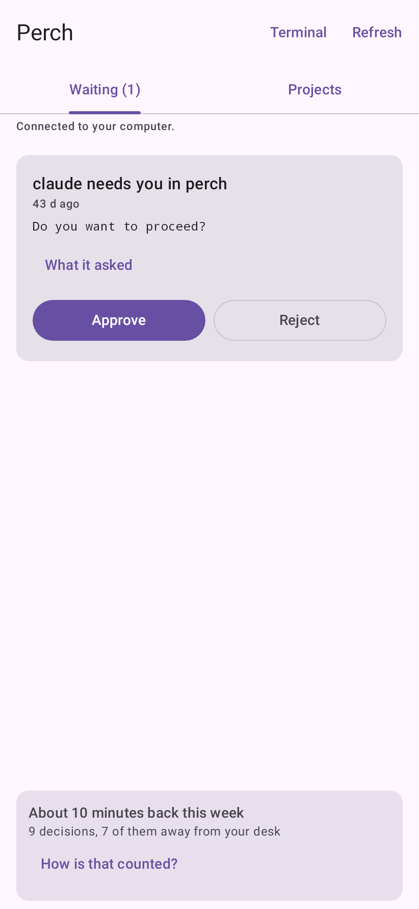
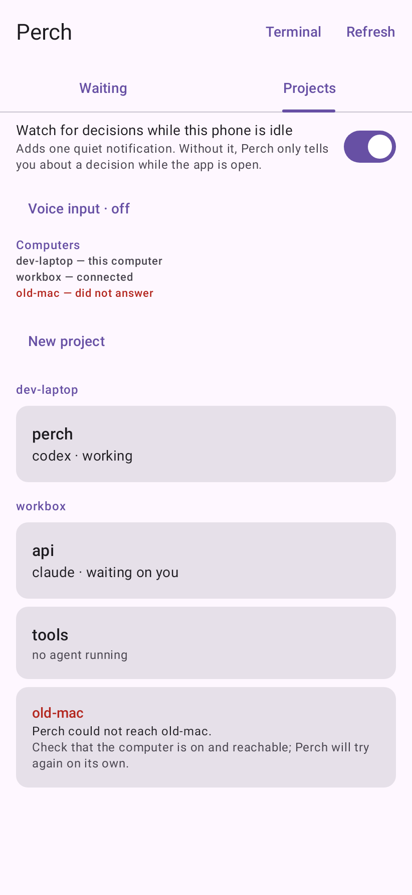
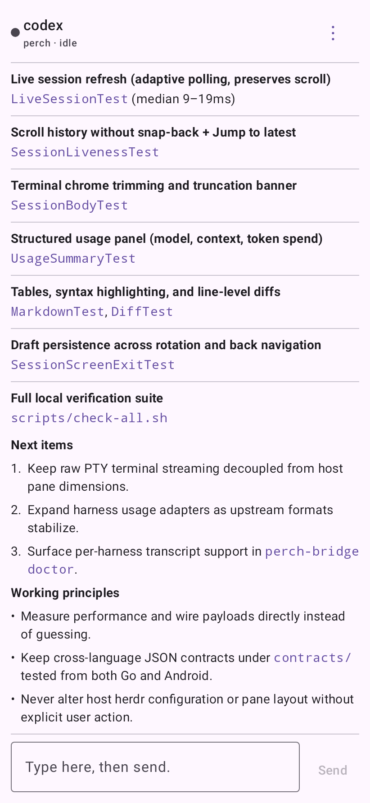
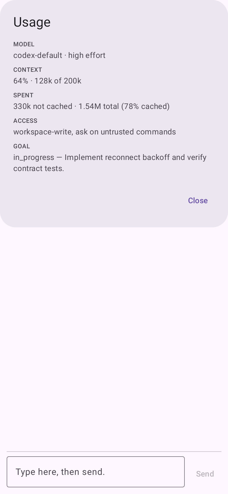

<div align="center">

# Perch

**A local-first Android console for coding agents running on your own computer.**

Approve permission prompts, read agent output, jump into a live `xterm.js` terminal, or open a standalone host shell over Tailscale or LAN — with no cloud account and no code leaving your machine.

[](https://github.com/th2zz/perch/actions/workflows/ci.yml)
[](https://github.com/th2zz/perch/releases/latest)
[](LICENSE)
[-3DDC84?logo=android&logoColor=white)](app/)
[](bridge/)

[Screenshots](#screenshots) · [Features](#why-perch) · [Architecture](#architecture) · [Quick Start](#quick-start) · [Security](#security)

</div>

---

## Screenshots

<p align="center">
  
  
  
  
</p>

---

## Why Perch?

Running Claude Code, Codex, OpenCode, or other CLI agents on your workstation usually stops the moment you step away from your desk. Raw mobile SSH clients force you to pinch-zoom a desktop terminal and constantly check whether an agent is stuck.

Perch pairs an Android client with a lightweight Go daemon (`perch-bridge`) on top of [`herdr`](https://github.com/herdrdev/herdr):

- **Attention queue instead of terminal babysitting**: Get notified when an agent blocks for approval or asks a question. Approve, reject, or reply in one tap; if a dialog cannot be mapped unambiguously, Perch refuses to guess and opens the live session instead.
- **Real terminal without disturbing your desktop layout**: Viewing a `herdr` pane streams live VT bytes into `xterm.js` with pinch zoom and keyboard-aware scrolling without resizing your computer's pane geometry (explicit resize stays available on demand).
- **Standalone host shell**: Drop into an independent PTY shell on your computer (`git status`, logs, restarts) with automatic reconnect across Wi-Fi and cellular switches.
- **Multi-host & multi-agent**: Monitor local and remote SSH `herdr` machines side by side, start new workspaces/sessions with harness readiness checks, and inspect structured transcripts and token usage.
- **Private by architecture**: No cloud server, no third-party proxy, no telemetry. Everything stays on your Tailscale tailnet or private LAN.

| | Raw Mobile SSH | Cloud-Relayed Agent UIs | **Perch** |
|---|---|---|---|
| **Code & prompts stay local** | Yes | Relayed via vendor servers | **Yes (Tailscale / LAN only)** |
| **One-tap approval notifications** | No | Sometimes | **Yes (attention queue + safe action whitelist)** |
| **Preserves desktop pane dimensions** | Often resizes PTY | N/A | **Yes (non-invasive viewer by default)** |
| **Multi-agent support** | Manual | Usually single-vendor | **Yes (any agent managed by `herdr`)** |
| **Standalone host shell** | Yes | No | **Yes (built-in PTY with auto-reattach)** |

---

## Architecture

```text
┌─────────────────────────┐          Tailscale / LAN          ┌──────────────────────────────┐
│   Perch Android App     │  ◄──── HTTP + WebSocket ────►     │        perch-bridge          │
│  (Kotlin + Compose +    │       Bearer pairing token        │  (Go daemon · port 45999)    │
│   xterm.js WebView)     │                                   │  • attention queue           │
└─────────────────────────┘                                   │  • terminal & shell streams  │
                                                              │  • systemd / launchd unit    │
                                                              └──────────────┬───────────────┘
                                                                             │ local socket / CLI
                                                              ┌──────────────▼───────────────┐
                                                              │            herdr             │
                                                              │  Claude · Codex · OpenCode…  │
                                                              └──────────────────────────────┘
```

### Engineering Notes

- **Cross-language contract tests**: Go (`bridge/`) and Kotlin (`app/`) validate wire schemas, event names, vocabulary, and pairing links against shared fixtures in [`contracts/`](contracts/).
- **Non-invasive host integration**: Perch communicates through `herdr` without modifying your `herdr` configuration.
- **Hardened client storage**: Pairing tokens are encrypted with `AndroidKeyStore`, and cloud backup / device transfer extraction is explicitly disabled (`allowBackup="false"` + `data_extraction_rules.xml`), enforced by [`SecurityPostureTest`](app/app/src/test/java/dev/perch/console/SecurityPostureTest.kt).

### Repository Layout

| Directory | Description |
|---|---|
| [`app/`](app/) | Android client (Kotlin, Jetpack Compose, Material 3, local `xterm.js` WebView). |
| [`bridge/`](bridge/) | Go host daemon (`perch-bridge`) bridging `herdr` and the Android client. |
| [`plugin/`](plugin/) | `herdr` plugin manifest (`herdr-plugin.toml`) for startup hooks and quick actions. |
| [`relay/`](relay/) | Optional stateless push gateway with a strict payload field whitelist. |
| [`contracts/`](contracts/) | Shared JSON contracts verified by both Go and Android test suites. |
| [`scripts/`](scripts/) | Build, verification, and release automation scripts. |

---

## Quick Start

### Tested Environment & Prerequisites

- **Tested on**: **WSL2** (host) and **Android 16** (phone).
- **Expected to work in principle (not yet verified on physical hardware)**: Native Linux (desktop or cloud VM), macOS (`launchd`), and Android 13–15 (`minSdk 33`). Cross-compilation and `systemd`/`launchd` unit syntax checks pass in CI; test reports and PRs are welcome.
- **Host dependency**: [`herdr`](https://github.com/herdrdev/herdr) (`>= 0.9.0`).
- **Network**: Tailscale (recommended) or a shared private LAN between your phone and computer.

### 1. Install `perch-bridge` on your computer

**Option A — Prebuilt binary (fastest)**

Download the binary for your platform from [GitHub Releases](https://github.com/th2zz/perch/releases/latest):

```bash
# Linux amd64 example (also available: linux-arm64, darwin-amd64, darwin-arm64)
mkdir -p ~/.local/bin
curl -fL https://github.com/th2zz/perch/releases/latest/download/perch-bridge-linux-amd64 \
  -o ~/.local/bin/perch-bridge
chmod +x ~/.local/bin/perch-bridge
```

**Option B — Install with Go**

```bash
go install github.com/th2zz/perch/bridge/cmd/perch-bridge@latest
```

**Register and verify the user service** (`systemd --user` on Linux/WSL or `launchd` on macOS):

```bash
perch-bridge install-service
perch-bridge doctor
```

*(Optional)* Link the `herdr` plugin for workspace actions and startup hooks:

```bash
herdr plugin link "$PWD/plugin"
```

### 2. Generate a pairing link

```bash
perch-bridge pair
```

This outputs a `perch://pair?...` link alongside your host address and bearer token.

### 3. Install the Android app and pair

1. Download `perch-<version>.apk` from [GitHub Releases](https://github.com/th2zz/perch/releases/latest) on your Android device and install it.
2. Open the `perch://pair?...` link on your phone (or enter the address and token manually).
3. Active `herdr` workspaces and waiting agent prompts appear immediately.

### Uninstall

```bash
perch-bridge uninstall-service
```

---

## Building from Source

```bash
# Build perch-bridge
(cd bridge && go build -o ~/.local/bin/perch-bridge ./cmd/perch-bridge)

# Cross-compile bridge binaries for Linux & macOS (amd64/arm64)
scripts/build-binaries.sh

# Build debug Android APK
(cd app && ./gradlew :app:assembleDebug)

# Run local verification suite (Go bridge & relay, Android tests & lint, terminal page Node tests)
scripts/check-all.sh --quick
```

To build a signed release APK locally, generate a signing keystore outside the repository once:

```bash
scripts/make-release-key.sh
(cd app && ln -sf ~/.perch/keystore.properties keystore.properties && ./gradlew :app:assembleRelease)
```

---

## Security

Perch assumes a private network boundary (Tailscale, WireGuard/VPN, or a trusted LAN). **Do not expose port `45999` directly to the public internet.** See [SECURITY.md](SECURITY.md) for the full threat model and reporting policy.

## Contributing

Contributions, bug reports, and platform verification reports (native Linux, macOS, Android 13–15) are welcome. See [CONTRIBUTING.md](CONTRIBUTING.md) to get started.

## License

MIT License — see [LICENSE](LICENSE) and [THIRD_PARTY_NOTICES.md](THIRD_PARTY_NOTICES.md).
